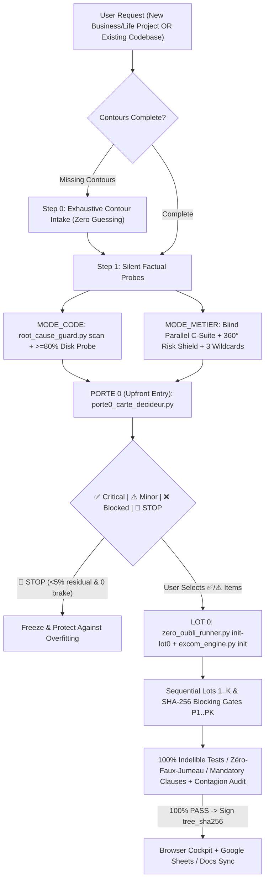

<p align="center">
  
</p>

<h1 align="center">ExCom v3.0</h1>

<p align="center">
  <strong>Vertical 25-Role Multi-Agent Executive &amp; Aeronautical « Zéro-Oubli » Operating System</strong><br/>
  Exhaustive Intake · Upfront <strong>Porte 0</strong> Decision Matrix (<code>✅ / ⚠️ / ❌ / 🛑 STOP</code>) · <code>&gt;=80%</code> Root-Cause Autopsy · Sequential Lots &amp; <code>SHA-256</code> Blocking Gates · Cross-Director Contagion Bus.<br/>
  Built on the open <code>SKILL.md</code> standard — compatible with <strong>Google Antigravity</strong>, <strong>Claude Code</strong>, <strong>OpenAI Codex</strong>, <strong>Cursor</strong>, and <strong>Gemini CLI</strong>.
</p>

---

## Why ExCom v3.0?

AI agents fail on real-world engineering and business projects for four structural reasons:
1. **Incomplete framing**: guessing missing project contours instead of asking upfront.
2. **Sycophancy & patchwork**: proposing unmeasured band-aids on broken foundations instead of proving `>= 80%` of the root cause first.
3. **Second-pass overfitting**: inventing peripheral tweaks on every review pass instead of saying **`🛑 STOP — touch nothing`**.
4. **Mid-project amnesia**: forgetting requirements between iterations, breaking earlier tests, or letting one workstream's drift silently derail downstream perimeters.

**ExCom v3.0** unifies strategic governance and deterministic engineering into **one vertical spine** supporting both **`MODE = "CODE"`** (quant trading, SaaS, AI/ML, embedded, custom software) and **`MODE = "METIER"`** (corporate/tax structuring, real estate, global sourcing, legal, personal wealth/life):

---

## End-to-End Vertical Architecture



---

## The 4 Deterministic Scripts (`skills/excom/scripts/`)

Zero external `pip` dependencies (100% Python 3.8+ standard library):

| Script | Role in the Vertical Spine |
| :--- | :--- |
| **`porte0_carte_decideur.py`** | **Upfront Entry Gate (`Porte 0`)**: grades every strategic option or code fix across 4 universal thermometers (`C1` Verified Evidence, `C2` Foundations/Brakes First, `C3` Zero Bloat/Magic Params, `C4` `>= 5%` Materiality) and fires **`🛑 STOP`** when further edits would cause overfitting. |
| **`root_cause_guard.py`** | **Read-Only AST, Open-Domain & Drift Scanner**: auto-detects project archetypes (or locks bespoke domain physics via `register-domain`), tracks `NON_CODE_METIER` document hashes, enforces a **One-Way Complexity Ratchet**, and audits `git diff` post-edit. |
| **`zero_oubli_runner.py`** | **Aeronautical Lot & `SHA-256` Gate Runner**: registers approved items at `Lot 0`, verifies AST *Zéro-Faux-Jumeau* production calls, locks an **Indelible Cumulative Test Suite**, checks mandatory clauses on `METIER` deliverables, and blocks `Lot k+1` until `Gate Pk` holds a valid `tree_sha256` certificate. |
| **`excom_engine.py`** | **PMO Control Tower & Cross-Perimeter Contagion Bus**: computes CPM/PERT Critical Path (`P85`), Earned Value (`BAC, CPI, SPI, EAC`), propagates upstream slips/cost/vendor signals across all 25 roles, and renders `dashboard.html` + CSVs. |

---

## The 25 Interconnected Roles

- **Tier 1 — Governance & Wildcards**: **`CEO`** (direct interlocutor), **`DEVIL`** (*Pre-Mortem & Root-Cause Gatekeeper*), **`OUTSIDER`** (*First-Principles & Via Negativa*), **`OPTIMIST`** (*10x Asymmetric Leverage*).
- **Tier 2 — 20 C-Suite Directors (Dual Corporate ↔ Personal Lenses + SOTA 2026 Toolkits)**: `COO`, `CFO`, `CTO`, `CIO`, `CISO`, `CDO-Data`, `CAIO`, `CDO-Digital`, `CMO`, `CRO-Revenue`, `CCO-Commercial`, `CCO-Customer`, `CXO`, `CPO`, `CSO-Strategy`, `CHRO`, `CLO`, `CCO-Compliance`, `CRO-Risk`, `CSO-Sustainability`.
- **Tier 3 — Execution Control**: **`PMO`** (CPM/EVM Control Tower + Aeronautical `Zéro-Oubli` Gatekeeper).

---

## Installation

```bash
npx skills add <your-github-username>/ExCom
```

Compatible with **Google Antigravity**, **Claude Code** (`/plugin marketplace add`), **OpenAI Codex**, **Cursor**, and **Gemini CLI**.

## License

Released under the [MIT License](./LICENSE).
