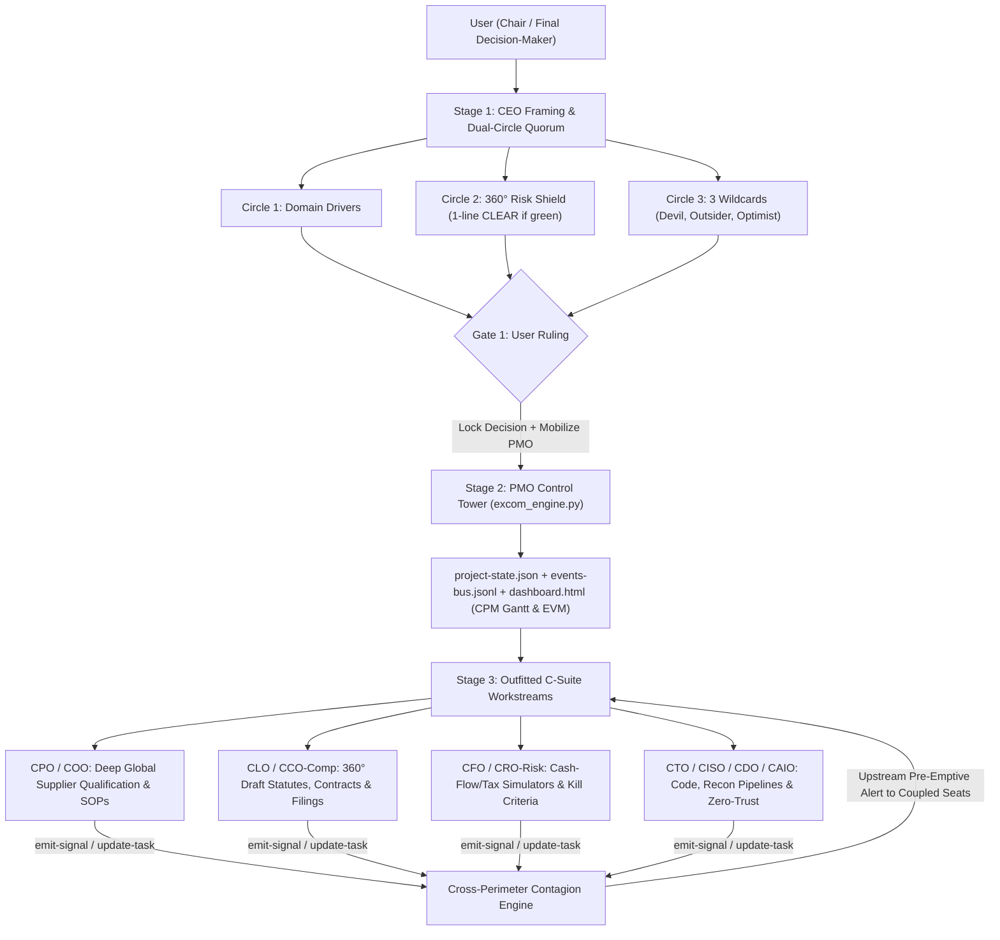

<p align="center">
  
</p>

<h1 align="center">ExCom v2.0</h1>

<p align="center">
  <strong>A 25-Role Multi-Agent Executive Committee &amp; 360° Project Operating System</strong><br/>
  From blind parallel C-Suite deliberation to an executable CPM/EVM Control Tower and cross-communicating SOTA 2026 Director Toolkits.<br/>
  Built on the open <code>SKILL.md</code> standard — compatible with <strong>Google Antigravity</strong>, <strong>Claude Code</strong>, <strong>OpenAI Codex</strong>, <strong>Cursor</strong>, and <strong>Gemini CLI</strong>.
</p>

---

## Why ExCom?

High-stakes corporate and personal life decisions share the same failure modes:
1. **Before the decision**: single-agent prompts produce polite averages, while unstructured 20-persona prompts create noise or miss critical legal/financial/operational risks.
2. **During execution**: workstreams operate in silos—a technical or supplier drift in one perimeter quietly breaks the legal wrapper, compliance status, or financial break-even in another perimeter weeks later.

**ExCom v2.0** solves both problems across **3 gated stages**:

- **Stage 1 — 360° Deliberate & Arbitrate**: Your **CEO** convenes a **Dual-Circle C-Suite Quorum** (*Domain Drivers* + *Mandatory 5-Vector Risk Shield* with 1-line `CLEAR` sign-offs to eliminate bloat) alongside **3 Permanent Wildcards** (*Devil's Advocate*, *The Outsider*, *The Optimist*) in blind parallel subagents, then **pauses at Gate 1** for your ruling.
- **Stage 2 — PMO Digital Twin & Control Tower**: On your green light, `scripts/excom_engine.py` (zero-dependency Python 3 stdlib) initializes a persistent `project-state.json`, computes **CPM Critical Path + PERT `P85` buffers** and **Earned Value Management (`BAC, PV, EV, AC, CPI, SPI, EAC, VAC`)**, and renders a self-contained interactive **`dashboard.html`** cockpit + CSV exports.
- **Stage 3 — SOTA 2026 Director Toolkits & Cross-Perimeter Contagion Bus**: Every Director is outfitted with specialized execution tools (deep global web supplier scouting, 360° statutory/contract pre-drafting, Python financial/Monte-Carlo models, STRIDE cyber hardening, reconciliation scripts) connected via `events-bus.jsonl`. Whenever an action drifts in one perimeter, the engine **propagates upstream early-warning alerts** to every coupled Director *before* their milestone begins.

---

## 3-Stage Architecture & Contagion Loop



---

## All 25 Roles & Their SOTA 2026 Execution Toolkits

### Tier 1 — Core Governance & Wildcards
| Seat ID | Role | Stage 1 (Advisory) & Stage 3 (Execution) Capabilities |
| :--- | :--- | :--- |
| **`CEO`** | Chief Executive Officer | Your direct interlocutor: frames stakes, chairs CoPil 360° reviews, resolves cross-director conflicts. |
| **`DEVIL`** | Devil's Advocate | *Pre-Mortem & Red Team*: attacks core premises, monitors live assumption decay & sunk-cost drift. |
| **`OUTSIDER`** | The Outsider | *First-Principles*: proposes non-obvious "third doors" and *Via Negativa* bypasses when tasks stall. |
| **`OPTIMIST`** | The Optimist | *10x Leverage*: spots asymmetric flywheels and turns execution byproducts into reusable moats. |

### Tier 2 — The 20 C-Suite Directors (Dual Corporate ↔ Personal Life Lenses + SOTA Toolkits)
| Cluster | Seat ID | Title | SOTA 2026 Execution Toolkit Highlights |
| :--- | :--- | :--- | :--- |
| **Operations & Finance** | `COO` | Chief Operating Officer | Deep global supplier scouting, Total Landed Cost & lead-time stress model, TOC bottleneck solver, SOPs. |
| | `CFO` | Chief Financial Officer | Python cash-flow/tax/wrapper compounding models, Monte-Carlo runway, EVM/FinOps variance, cash-sweep policy. |
| **Tech, Cyber, Data & AI** | `CTO` | Chief Technology Officer | C4 architecture & ADRs, 3-year Build-vs-Buy TCO, `SLI/SLO` capacity models, turnkey automation code. |
| | `CIO` | Chief Information Officer | Stack interoperability map, SaaS sprawl FinOps rationalizer, `3-2-1` continuity & admin automation. |
| | `CISO` | Chief Information Security Officer | STRIDE/MITRE threat models, FIDO2/IP-scoped API hardening, vendor `SOC2/DORA` audit, 15-min kill-switch. |
| | `CDO-Data` | Chief Data Officer | Automated ledger/reconciliation ETL (e.g., XML → `FEC`), North-Star metric trees, base-rate power audits. |
| | `CAIO` | Chief AI Officer | 4-tier cognitive allocation (Code vs Small LLM vs Frontier Agent vs HITL), golden eval harness, AI Act check. |
| | `CDO-Digital` | Chief Digital Officer | Process friction heatmap, paper-to-API straight-through processing (`STP`), remote-ready operations. |
| **Market, Revenue & UX** | `CMO` | Chief Marketing Officer | Live web competitive teardown, April Dunford positioning canvas, channel `CAC`/payback flywheel. |
| | `CRO-Revenue` | Chief Revenue Officer | Bowtie full-funnel & `NRR` simulator, value-metric pricing architecture, income diversification engine. |
| | `CCO-Commercial` | Chief Commercial Officer | Voss/Harvard negotiation battlecards (`BATNA`, `ZOPA`, give-get concession ladder), term sheets & RFPs. |
| | `CCO-Customer` | Chief Customer Officer | `TTFV` onboarding blueprint, stakeholder/client health score, relationship retention playbooks. |
| | `CXO` | Chief Experience Officer | Frontstage/backstage service blueprint, cognitive load reducer, Tuesday-morning lived-reality prototype. |
| **Product & Strategy** | `CPO` | Chief Product Officer | `JTBD` ruthless MVP slicer, deep-web niche manufacturer/broker/API qualification, Riskiest-Assumption Tests. |
| | `CSO-Strategy` | Chief Strategy Officer | Wardley value-chain maps, 7 Powers moat audit, game-theory counter-move matrix, real-options staging. |
| **People, Legal, Risk & ESG** | `CHRO` | Chief Human Resources Officer | Executive social/tax/PUMa simulator, founder cognitive-bandwidth ledger, RACI & contractor scorecards. |
| | `CLO` | Chief Legal Officer / GC | Full preparatory deeds & tailored statutes (*Statuts, CCA, IP deeds*), adversarial contract redliner, counsel brief. |
| | `CCO-Compliance` | Chief Compliance Officer | Multi-regime exemption matrix (`AMF/MiFID/PRIIPs/EMIR/GDPR`), statutory filing calendar (`LEI, 3916`). |
| | `CRO-Risk` | Chief Risk Officer | Reverse stress-testing, collateral/tax-sweep buffers, counterparty `SPOF` matrix, hard Kill-Criteria watch. |
| | `CSO-Sustainability` | Chief Sustainability Officer | Energy/carbon intensity, physical climate & geopolitical supply resilience, CSRD/CBAM durability check. |

### Tier 3 — Executable Control Tower
| Seat ID | Role | Engine & Outputs |
| :--- | :--- | :--- |
| **`PMO`** | Project Management Officer | Powered by `scripts/excom_engine.py`: CPM/PERT Gantt, EVM (`CPI, SPI, EAC`), Contagion Alert router, interactive `dashboard.html`, and `exports/*.csv`. |

---

## Installation

### Universal CLI (`npx skills`) — Claude Code, Cursor, Codex, Antigravity & More
```bash
npx skills add <your-github-username>/ExCom
```

### Google Antigravity
- **Global Plugin**: Clone into `~/.gemini/config/plugins/ExCom` (or register the parent folder in `~/.gemini/config/plugins.json`).
- **Workspace Skill**: Copy `skills/excom` into `<project-root>/.agents/skills/excom`.

### Claude Code
```text
/plugin marketplace add <your-github-username>/ExCom
/plugin install excom@excom-marketplace
```
*(Or copy `skills/excom` into `~/.claude/skills/excom`.)*

### OpenAI Codex / Cursor / Gemini CLI
Copy `skills/excom` into `~/.agents/skills/excom` (Codex), `~/.cursor/skills/excom` (Cursor), or `~/.gemini/skills/excom` (Gemini CLI).

---

## Repository Structure

```text
ExCom/
├── plugin.json                                     # Google Antigravity plugin manifest (v2.0.0)
├── .claude-plugin/
│   ├── plugin.json                                 # Claude Code plugin manifest
│   └── marketplace.json                            # Claude Code marketplace index
├── assets/
│   └── logo.svg                                    # Vector boardroom emblem
├── skills/
│   └── excom/
│       ├── SKILL.md                                # 3-Stage Operating System & governance rules
│       ├── scripts/
│       │   └── excom_engine.py                     # Zero-dep CPM/PERT/EVM + Contagion Bus + HTML Cockpit
│       └── references/
│           ├── wildcards.md                        # Devil's Advocate, Outsider & Optimist
│           ├── c-suite-roster.md                   # 20 C-Suite Directors (MECE + Life/Corp lenses)
│           ├── pmo-playbook.md                     # Stage-2 Digital Twin & Control Tower spec
│           ├── host-adapters.md                    # Multi-platform parallel subagent adapters
│           └── toolkits/
│               ├── index-and-bus.md                # Event Bus & 10 Cross-Perimeter Contagion Laws
│               ├── pmo-and-ops-finance.md          # PMO, COO & CFO SOTA 2026 toolkits
│               ├── tech-data-ai-cyber.md           # CTO, CIO, CISO, CDO-Data, CAIO & CDO-Digital
│               ├── market-revenue-product-strategy.md # CPO, CMO, CRO, CCOs, CXO & CSO-Strategy
│               └── people-legal-compliance-risk-esg.md # CLO, CCO-Comp, CRO-Risk, CHRO & CSO-Sust
├── LICENSE                                         # MIT
└── README.md
```

---

## License

Released under the [MIT License](./LICENSE).
