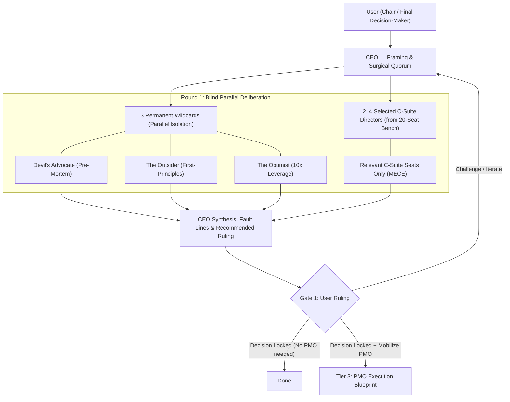

<p align="center">
  
</p>

<h1 align="center">ExCom</h1>

<p align="center">
  <strong>A Multi-Agent Executive Committee Skill for High-Stakes Corporate &amp; Personal Decisions</strong><br/>
  Built on the open <code>SKILL.md</code> standard — compatible with <strong>Google Antigravity</strong>, <strong>Claude Code</strong>, <strong>OpenAI Codex</strong>, <strong>Cursor</strong>, and <strong>Gemini CLI</strong>.
</p>

---

## Why ExCom?

Most high-stakes decisions—whether launching a product, structuring an acquisition, negotiating compensation, buying real estate, or relocating your family—are governed by the **same underlying variables**: capital allocation, opportunity cost, legal exposure, operational friction, asymmetric upside, tail risk, and human bandwidth.

Asking a single AI prompt *"What should I do?"* produces polite, hedged averages. Dumping 20 personas into one prompt produces corporate noise.

**ExCom** models how elite executive committees actually operate:

1. **You are the Chair of the Board** (final decision-maker).
2. **The CEO** is your single interlocutor: frames the decision, selects a **surgical quorum of 2–4 C-Suite Directors** from a 20-seat bench (never summoning irrelevant seats), pairs them with **3 Permanent Lateral-Thinking Wildcards**, and runs **blind parallel deliberation** so advisors cannot anchor on each other.
3. **Gate 1 (Arbitration Stop)**: The CEO exposes the real fault lines, recommends a clear ruling with non-negotiable guardrails, and **hands the gavel back to you**.
4. **Gate 2 (Optional PMO Structuring)**: Only *after* you rule and opt in, the **Project Management Officer (PMO)** turns your locked-in decision into a concrete critical-path blueprint—zero wasted planning on rejected options.

---

## Architecture & Decision Circuit



---

## The 25 Roles Inside ExCom

### Tier 1 — Core Governance & Lateral-Thinking Wildcards
| Seat ID | Role | Mandate |
| :--- | :--- | :--- |
| **`CEO`** | Chief Executive Officer | Your direct interlocutor. Frames the stakes, picks the quorum, exposes clashes, recommends a ruling. |
| **`DEVIL`** | Devil's Advocate / Contrarian | *Pre-Mortem & Red Team*: attacks core premises, cognitive biases, irreversible traps, and tail risks. |
| **`OUTSIDER`** | The Outsider | *First-Principles*: strips away industry/social dogma and proposes non-obvious "third doors." |
| **`OPTIMIST`** | The Optimist | *Asymmetric Upside*: hunts for 10x leverage, compounding flywheels, and constraint-flipping moves. |

### Tier 2 — The 20 Actionable C-Suite Directors (2–4 Summoned per Session)
Every seat carries a **dual Corporate ↔ Personal Life lens** (so a `CFO` evaluates burn/IRR on a SaaS launch, and net-worth/liquidity/tax TCO on a personal home purchase—without awkward corporate jargon):

| Cluster | Seat ID | Title | Corporate Scope ↔ Personal / Life Scope |
| :--- | :--- | :--- | :--- |
| **Operations & Finance** | `COO` | Chief Operating Officer | Daily throughput & SOPs ↔ Daily logistics, commute & calendar realism |
| | `CFO` | Chief Financial Officer | Cash flow, unit economics, IRR ↔ Net worth, liquidity runway, tax & TCO |
| **Tech, Data & AI** | `CTO` | Chief Technology Officer | Product architecture & tech debt ↔ Structural/technical durability of assets |
| | `CIO` | Chief Information Officer | Internal IT stack & uptime ↔ Personal productivity stack & admin automation |
| | `CISO` | Chief Information Security Officer | Cyber defense & zero-trust ↔ Personal/family opsec, fraud & privacy protection |
| | `CDO-Data` | Chief Data Officer | Telemetry, KPIs & sample rigor ↔ Empirical base rates & measurable tracking |
| | `CAIO` | Chief AI Officer | Agentic ROI & AI moats ↔ AI career resilience & personal AI multipliers |
| | `CDO-Digital` | Chief Digital Officer | Legacy-to-digital transformation ↔ Modernizing workflows & remote leverage |
| **Market, Revenue & Customer** | `CMO` | Chief Marketing Officer | Positioning, brand & demand ↔ Personal brand, signaling & reputation capital |
| | `CRO-Revenue` | Chief Revenue Officer | End-to-end revenue & retention ↔ Holistic income engine & diversification |
| | `CCO-Commercial` | Chief Commercial Officer | GTM, pricing & deal closing ↔ High-stakes negotiation tactics & BATNA |
| | `CCO-Customer` | Chief Customer Officer | Post-sale retention & trust ↔ Long-term health of family/partner/client bonds |
| | `CXO` | Chief Experience Officer | End-to-end UX & friction ↔ Lived Tuesday-morning quality of life & joy |
| **Product & Strategy** | `CPO` | Chief Product Officer | MVP scope & PMF validation ↔ Prototyping life/project moves before V3 lock-in |
| | `CSO-Strategy` | Chief Strategy Officer | Competitive moats & M&A ↔ 5–10 year trajectory coherence & macro positioning |
| **People, Legal, Risk & ESG** | `CHRO` | Chief Human Resources Officer | Talent, org & incentives ↔ Energy bandwidth, burnout prevention & values |
| | `CLO` | Chief Legal Officer / GC | Contracts, IP & liability ↔ Employment/lease/patrimonial legal protection |
| | `CCO-Compliance` | Chief Compliance Officer | Sector regulations & audits ↔ Tax residency, visas, permits & statutory rules |
| | `CRO-Risk` | Chief Risk Officer | Portfolio stress & concentration ↔ Uncorrelated buffers, insurance & Plan B |
| | `CSO-Sustainability` | Chief Sustainability Officer | ESG, carbon & supply resilience ↔ Climate/geographic durability & ethics |

### Tier 3 — Downstream Execution
| Seat ID | Role | Mandate |
| :--- | :--- | :--- |
| **`PMO`** | Project Management Officer | Activated **only after Gate 1** on your chosen decision: Charter, Critical Path, Budget/Bandwidth Envelope, Kill Criteria, and Day-1 Next 3 Actions. |

---

## Installation

### Universal CLI (`npx skills`) — Claude Code, Cursor, Codex, Antigravity & More
```bash
npx skills add <your-github-username>/ExCom
```

### Google Antigravity
- **As a Plugin (Global)**: Clone into `~/.gemini/config/plugins/ExCom` (or point `~/.gemini/config/plugins.json` to the parent folder).
- **Workspace-Scoped Skill**: Copy `skills/excom` into `<project-root>/.agents/skills/excom`.

### Claude Code
- **Via Plugin Marketplace**:
  ```text
  /plugin marketplace add <your-github-username>/ExCom
  /plugin install excom@excom-marketplace
  ```
- **Direct Skill Copy**: Copy `skills/excom` into `~/.claude/skills/excom` (global) or `.claude/skills/excom` (project).

### OpenAI Codex / Cursor / Gemini CLI
Copy `skills/excom` into your agent's skill discovery path:
- **Codex**: `~/.agents/skills/excom` (or `.agents/skills/excom`)
- **Cursor**: `~/.cursor/skills/excom` (or `.cursor/skills/excom`)
- **Gemini CLI**: `~/.gemini/skills/excom` (or `.gemini/skills/excom`)

---

## Usage Examples

ExCom automatically mirrors **whatever language you write in** (English, French, Spanish, German, Japanese, etc.).

### 1. Corporate / Startup Strategy
> *"Convene the ExCom: we're a 6-person B2B software team with 14 months of runway ($650k). Should we pivot full-time to our new autonomous agent product or keep servicing enterprise consulting contracts to stay cash-flow positive?"*

### 2. Personal / Life & Wealth Decision
> *"Run an ExCom session: my partner and I are considering relocating from Paris to Lisbon while keeping remote senior roles, vs buying a family apartment locally with a 25-year mortgage."*

### 3. Stage 2 — Handing Off to the PMO (After Gate 1)
> *"We go with Option B, adding the CLO's exit-clause condition and the CFO's 9-month cash floor. Have the PMO structure the execution plan."*

---

## Repository Structure

```text
ExCom/
├── plugin.json                         # Native Google Antigravity plugin manifest
├── .claude-plugin/
│   ├── plugin.json                     # Native Claude Code plugin manifest
│   └── marketplace.json                # Claude Code marketplace index
├── assets/
│   └── logo.svg                        # Vector boardroom emblem
├── skills/
│   └── excom/
│       ├── SKILL.md                    # Core ExCom governance circuit & CEO rules
│       └── references/
│           ├── wildcards.md            # Devil's Advocate, Outsider & Optimist mandates
│           ├── c-suite-roster.md       # All 20 C-Suite Directors (MECE + Life/Corp lenses)
│           ├── pmo-playbook.md         # Stage-2 PMO execution blueprint spec
│           └── host-adapters.md        # Multi-agent parallel execution adapters
├── LICENSE                             # MIT
└── README.md
```

---

## License

Released under the [MIT License](./LICENSE).
