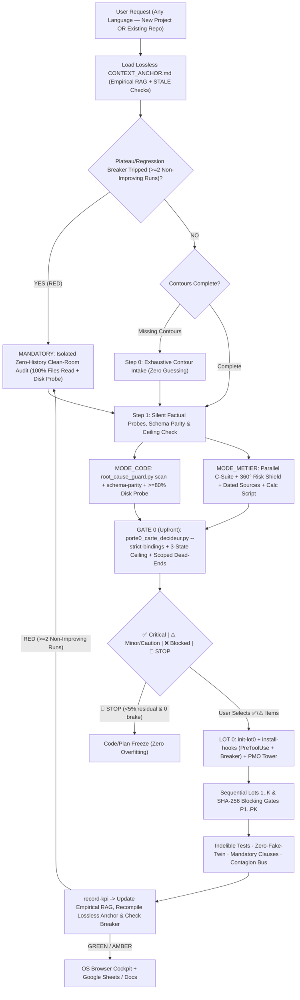

<p align="center">
  
</p>

<h1 align="center">ExCom v3.2</h1>

<p align="center">
  <strong>Vertical 25-Role Multi-Agent Executive &amp; Aeronautical « Zero-Amnesia » Operating System</strong><br/>
  Plateau Circuit Breaker &amp; 100% <strong>Clean-Room Audits</strong> · 3-State Foundation Ceiling (<code>DEAD / SUB-SCALE / VIABLE</code>) · Anti-Self-Certification <strong>Gate 0</strong> (<code>✅ / ⚠️ / ❌ / 🛑 STOP</code>) · Falsifiable Dead-Ends · Mock-vs-Real Schema Parity · Physical <code>PreToolUse</code> Firewall · Lossless Context Anchor · <code>SHA-256</code> Blocking Gates.<br/>
  Built on the open <code>SKILL.md</code> standard — compatible with <strong>Google Antigravity</strong>, <strong>Claude Code</strong>, <strong>OpenAI Codex</strong>, <strong>Cursor</strong>, and <strong>Gemini CLI</strong>.
</p>

---

## Why ExCom?

AI agents fail on complex engineering, financial, and business projects for seven structural reasons:
1. **Incomplete framing**: guessing missing project contours instead of asking upfront.
2. **Self-certified Gate 0 hallucinations**: writing `fact_verified: true` on claims that contradict actual files on disk or unparsed probe outputs.
3. **Incremental tunnel vision & ping-pong loops**: spending 4+ iterations patching regressions of the previous patch while reporting `RAG: GREEN`—never stepping back to audit 100% of the system from scratch.
4. **The binary `> 0` viability trap**: freezing a barely-positive core engine forever even when its theoretical zero-friction ceiling is mathematically below the North-Star target, then proposing suicidal leverage/scaling to force the gap.
5. **Dogmatic fossilization**: permanently burying hypotheses from confounded multi-change runs or replaying stale anchor invariants without falsifiability.
6. **Complacent test twins & silent code discards**: passing local mocks that inject fake schema keys absent from real production data, or silently dropping live inputs (`_ = param`) and freezing Day-1 state caches.
7. **Second-pass overfitting & lossy compaction**: inventing peripheral tweaks instead of saying **`🛑 STOP — DO NOT TOUCH`**, or losing exact precision through recursive "summaries of summaries."

**ExCom v3.2** locks all seven failure modes mechanically across **`MODE = "CODE"`** (quant trading, SaaS, AI/ML, embedded, custom software) and **`MODE = "METIER"`** (corporate/tax structuring, real estate, global sourcing, legal, personal wealth/life)—rendering **US English (`en-US`)** visual chrome while speaking **whatever language the user writes in**.

---

## End-to-End Vertical Architecture



---

## The 4 Deterministic Engines (`skills/excom/scripts/`)

Zero external `pip` dependencies (`Python 3.8+` standard library):

| Script | Deterministic Guarantees Enforced (`v3.2`) |
| :--- | :--- |
| **`porte0_carte_decideur.py`** | **Gate 0 Anti-Self-Certification Matrix**: Clean-Room Circuit Breaker gate, **3-State Foundation Ceiling** (`DEAD` / `SUB-SCALE` unlocking core redesign & blocking suicidal leverage / `VIABLE`), programmatic **`evidence_bindings`** verification against real files & parsed probe JSON (`--strict-bindings`), **Falsifiable Scoped Dead-Ends** (`ISOLATED_ABLATION` vs `CONFOUNDED_BUNDLE`, `reopen-dead-end`), Zero Mental Math (`ADD_03`), and **`🛑 STOP`** verdict. |
| **`root_cause_guard.py`** | **Read-Only AST, Blind-Spot & Schema-Parity Scanner**: detects patchwork (denoised `entity_exceptions`, `hardcoded_exclusions`, `boolean_hotspots`, `magic_literals`, `fixed_caps`), **`silent_discards` (`_ = param`)**, **`frozen_state_latches`**, **`stacked_clamps_advisory`**, and **`schema-parity`** (test-mock keys absent from real data JSONs), plus Open-Domain `register-domain`, One-Way Complexity Ratchet, and `git diff` audit. |
| **`zero_oubli_runner.py`** | **Aeronautical Runner, KPI Trajectory, Clean-Room Certifier & Lossless Anchor**: `Lot 0` ledger, **`record-kpi`** (tracks champion vs latest, flips Empirical RAG to `RED` & trips Circuit Breaker on `>= 2` non-improving runs), **`record-clean-room`** (enforces `100%` production file coverage + isolated auditor), **`install-hooks`** (`PreToolUse` firewall also enforcing the Circuit Breaker), AST *Zero-Fake-Twin* check, `tree_sha256` gates, and **`render-anchor`** with `[STALE]` equation detection. |
| **`excom_engine.py`** | **PMO Control Tower & Cross-Perimeter Contagion Bus**: CPM/PERT Critical Path (`P85`), Earned Value (`BAC, CPI, SPI, EAC`), transitive root-cause slip & cost alerts across all 25 roles, US-English `dashboard.html` & CSV exports. |

---

## The 25 Interconnected Roles

- **Tier 1 — Governance & Wildcards**: **`CEO`** (direct interlocutor), **`DEVIL`** (*Pre-Mortem & Root-Cause Gatekeeper*), **`OUTSIDER`** (*First-Principles & Via Negativa*), **`OPTIMIST`** (*10x Asymmetric Leverage*).
- **Tier 2 — 20 C-Suite Directors (Dual Corporate ↔ Personal Lenses + SOTA 2026 Toolkits)**: `COO`, `CFO`, `CTO`, `CIO`, `CISO`, `CDO-Data`, `CAIO`, `CDO-Digital`, `CMO`, `CRO-Revenue`, `CCO-Commercial`, `CCO-Customer`, `CXO`, `CPO`, `CSO-Strategy`, `CHRO`, `CLO`, `CCO-Compliance`, `CRO-Risk`, `CSO-Sustainability`.
- **Tier 3 — Execution Control**: **`PMO`** (CPM/EVM Control Tower + Aeronautical `SHA-256` Gatekeeper + Clean-Room Circuit Breaker).

---

## Installation

```bash
npx skills add Foch1974/ExCom
```

Compatible with **Google Antigravity**, **Claude Code** (`/plugin marketplace add`), **OpenAI Codex**, **Cursor**, and **Gemini CLI**.

## License

Released under the [MIT License](./LICENSE).
