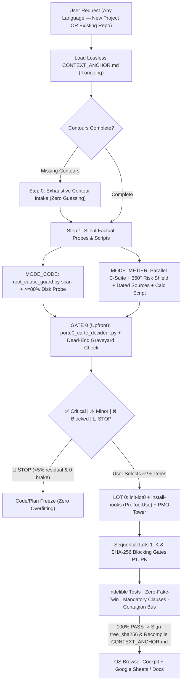

<p align="center">
  
</p>

<h1 align="center">ExCom v3.1</h1>

<p align="center">
  <strong>Vertical 25-Role Multi-Agent Executive &amp; Aeronautical « Zero-Amnesia » Operating System</strong><br/>
  Exhaustive Intake · Upfront <strong>Gate 0</strong> Decision Matrix (<code>✅ / ⚠️ / ❌ / 🛑 STOP</code>) · <code>&gt;=80%</code> Root-Cause Autopsy · Dead-End Anti-Loop · Physical <code>PreToolUse</code> Firewall · Lossless Context Anchor · <code>SHA-256</code> Blocking Gates.<br/>
  Built on the open <code>SKILL.md</code> standard — compatible with <strong>Google Antigravity</strong>, <strong>Claude Code</strong>, <strong>OpenAI Codex</strong>, <strong>Cursor</strong>, and <strong>Gemini CLI</strong>.
</p>

---

## Why ExCom?

AI agents fail on complex engineering, financial, and business projects for five structural reasons:
1. **Incomplete framing**: guessing missing project contours instead of asking upfront.
2. **Sycophancy & patchwork**: proposing unmeasured band-aids on broken foundations instead of proving `>= 80%` of the root cause first—or computing financial numbers via error-prone mental math.
3. **Second-pass overfitting**: inventing peripheral tweaks on every review pass instead of saying **`🛑 STOP — DO NOT TOUCH`**.
4. **Cross-session Groundhog Day**: forgetting why an idea failed two weeks ago and proposing the exact same dead-end again.
5. **Mid-project drift & lossy compaction**: skipping rules after 40 turns, losing exact numbers through recursive "summaries of summaries," or letting one workstream's drift derail downstream perimeters.

**ExCom v3.1** locks all five failure modes mechanically across **`MODE = "CODE"`** (quant trading, SaaS, AI/ML, embedded, custom software) and **`MODE = "METIER"`** (corporate/tax structuring, real estate, global sourcing, legal, personal wealth/life)—rendering **US English (`en-US`)** visual chrome while speaking **whatever language the user writes in**.

---

## End-to-End Vertical Architecture



---

## The 4 Deterministic Engines (`skills/excom/scripts/`)

Zero external `pip` dependencies (`Python 3.8+` standard library):

| Script | Deterministic Guarantees Enforced |
| :--- | :--- |
| **`porte0_carte_decideur.py`** | **Gate 0 Upfront Matrix**: 4 universal thermometers (`C1` Verified Proof & Zero Mental Math, `C2` Foundations First, `C3` Zero Bloat & **Dead-End Graveyard Anti-Loop** + `N_trials`, `C4` `>= 5%` Materiality) + **`🛑 STOP`** verdict. |
| **`root_cause_guard.py`** | **Read-Only AST, Open-Domain & Drift Scanner**: auto-detects archetypes (or locks bespoke domain physics via `register-domain`), tracks `NON_CODE_METIER` document hashes, enforces a **One-Way Complexity Ratchet**, and audits `git diff` post-edit. |
| **`zero_oubli_runner.py`** | **Aeronautical Runner, Physical Firewall & Lossless Anchor**: `Lot 0` ledger, **`install-hooks`** (`PreToolUse` physical block on uncertified edits, sacred files & test deletions), AST *Zero-Fake-Twin* check, `tree_sha256` gate certificates, and **`render-anchor`** (compiles `CONTEXT_ANCHOR.md` straight from primary JSONs—zero lossy LLM summarization across 50+ iterations). |
| **`excom_engine.py`** | **PMO Control Tower & Cross-Perimeter Contagion Bus**: CPM/PERT Critical Path (`P85`), Earned Value (`BAC, CPI, SPI, EAC`), transitive root-cause slip & cost alerts across all 25 roles, US-English `dashboard.html` & CSV exports. |

---

## The 25 Interconnected Roles

- **Tier 1 — Governance & Wildcards**: **`CEO`** (direct interlocutor), **`DEVIL`** (*Pre-Mortem & Root-Cause Gatekeeper*), **`OUTSIDER`** (*First-Principles & Via Negativa*), **`OPTIMIST`** (*10x Asymmetric Leverage*).
- **Tier 2 — 20 C-Suite Directors (Dual Corporate ↔ Personal Lenses + SOTA 2026 Toolkits)**: `COO`, `CFO`, `CTO`, `CIO`, `CISO`, `CDO-Data`, `CAIO`, `CDO-Digital`, `CMO`, `CRO-Revenue`, `CCO-Commercial`, `CCO-Customer`, `CXO`, `CPO`, `CSO-Strategy`, `CHRO`, `CLO`, `CCO-Compliance`, `CRO-Risk`, `CSO-Sustainability`.
- **Tier 3 — Execution Control**: **`PMO`** (CPM/EVM Control Tower + Aeronautical `SHA-256` Gatekeeper).

---

## Installation

```bash
npx skills add <your-github-username>/ExCom
```

Compatible with **Google Antigravity**, **Claude Code** (`/plugin marketplace add`), **OpenAI Codex**, **Cursor**, and **Gemini CLI**.

## License

Released under the [MIT License](./LICENSE).
