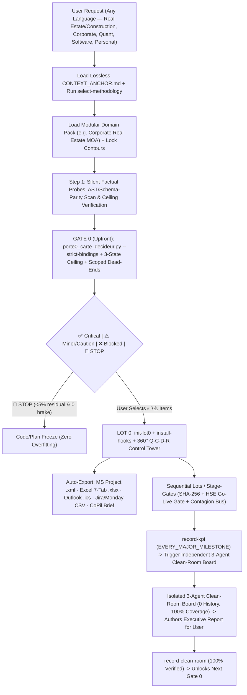

<p align="center">
  
</p>

<h1 align="center">ExCom v3.3</h1>

<p align="center">
  <strong>Vertical 25-Role Executive, 360° Enterprise PMO &amp; Aeronautical « Zero-Amnesia » Operating System</strong><br/>
  Adaptive <strong>Methodology Selector</strong> (6 Standards) · Systematic <strong>Post-Milestone Multi-Agent Clean-Room Boards</strong> · 3-State Foundation Ceiling · Anti-Self-Certification <strong>Gate 0</strong> (<code>✅ / ⚠️ / ❌ / 🛑 STOP</code>) · 360° <strong>Q-C-D-R Control Tower</strong> (Hard Deadlines, 5-Col Budget/TMA/TCO, EMV Risks, HSE/Reserves Go-Live Gate, Contract Redlines) · Native <strong>MS Project XML / Excel .xlsx / iCal .ics / CSV</strong> Bidirectional Interchange.<br/>
  Built on the open <code>SKILL.md</code> standard — compatible with <strong>Google Antigravity</strong>, <strong>Claude Code</strong>, <strong>OpenAI Codex</strong>, <strong>Cursor</strong>, and <strong>Gemini CLI</strong>.
</p>

---

## Why ExCom v3.3?

Both technical/quant projects and corporate enterprise programs (real estate, construction, IT/ERP, M&A) fail for the exact same structural reasons:
1. **The builder grades their own homework**: the agent or team that just built a lot defends its own blind spots instead of triggering an independent post-milestone review. **ExCom v3.3 enforces Separation of Powers**: immediately after **every major backtest or Stage-Gate milestone** (`EVERY_MAJOR_MILESTONE`), an isolated **3-Agent Clean-Room Board** (0 chat history, 100% file/deliverable coverage) authors the executive report directly for the Decision-Maker.
2. **Wrong methodology & siloed tools**: applying Agile to a regulated construction project (or Predictive to SaaS discovery), or locking project tracking inside proprietary prose instead of corporate-ready **MS Project XML, 7-Tab Excel `.xlsx`, Outlook `.ics`, Jira/Monday CSV, and Google Workspace**.
3. **Hidden Q-C-D-R blind spots**: missing negative float against a hard lease/contract deadline, 3-column budgets lacking Change Orders (`TMA`) & multi-year TCO, unquantified risks (`EMV`), unlifted HSE/regulatory reserves & missing Go-Live certificates, or toxic contract clauses.
4. **Self-certified Gate 0, binary `> 0` viability traps, & dogmatic dead-ends**: claiming `fact_verified: true` without checking files on disk, proposing suicidal leverage/scaling on a `SUB-SCALE` core, or fossilizing confounded multi-change failures.
5. **Complacent mocks, silent code discards & lossy compaction**: test suites injecting fake schema keys absent from real data, `_ = param` dropping live inputs, or recursive summaries losing atomic numbers.

**ExCom v3.3** locks all five failure modes deterministically with **zero external `pip` dependencies (`Python 3.8+` stdlib)**—rendering **US English (`en-US`)** visual chrome and exports while speaking **whatever language the user writes in**.

---

## End-to-End Vertical Architecture



---

## The 5 Deterministic Engines (`skills/excom/scripts/`)

Zero external `pip` dependencies (`Python 3.8+` standard library):

| Script | Deterministic Guarantees Enforced (`v3.3`) |
| :--- | :--- |
| **`porte0_carte_decideur.py`** | **Gate 0 Anti-Self-Certification Matrix**: Post-Milestone Clean-Room Board Gate, **3-State Foundation Ceiling** (`DEAD` / `SUB-SCALE` unlocking core redesign & blocking suicidal scaling / `VIABLE`), programmatic **`evidence_bindings`** (`--strict-bindings`), **Falsifiable Scoped Dead-Ends** (`ISOLATED_ABLATION` vs `CONFOUNDED_BUNDLE`, `reopen-dead-end`), Zero Mental Math (`ADD_03`), and **`🛑 STOP`** verdict. |
| **`zero_oubli_runner.py`** | **Aeronautical Runner, KPI Trajectory, Multi-Agent Clean-Room Certifier & Lossless Anchor**: `Lot 0` ledger, **`record-kpi`** (default `EVERY_MAJOR_MILESTONE` Separation of Powers + Empirical RAG), **`record-clean-room`** (`100%` coverage + `--panel-auditors` + `--dissenting-vetoes`), **`install-hooks`** (`PreToolUse` firewall), AST *Zero-Fake-Twin*, `tree_sha256` gates, and **`render-anchor`** with `[STALE]` alerts. |
| **`root_cause_guard.py`** | **Read-Only AST, Blind-Spot & Schema-Parity Scanner**: detects patchwork (denoised `entity_exceptions`, `hardcoded_exclusions`, `boolean_hotspots`, `magic_literals`, `fixed_caps`), **`silent_discards` (`_ = param`)**, **`frozen_state_latches`**, **`stacked_clamps_advisory`**, and **`schema-parity`** (test-mock keys absent from real data JSONs), plus `register-domain`, One-Way Ratchet, and `git diff` audit. |
| **`excom_engine.py`** | **360° Enterprise Q-C-D-R Control Tower & Contagion Bus**: CPM + PERT `P85`, `FS/SS/FF/SF + Lag`, **Hard Target Deadline & Negative Float**, **5-Column Budget (`BAC -> TMA -> Revised -> Committed -> AC -> ETC -> EAC -> VAC`)**, Contingency vs Management Reserve, Multi-Year TCO & S-Curve, **Quantified Risk Register (`EMV`)**, **HSE/Compliance/Testing/Reserves Go-Live Gate**, **Contractual Negotiation & Suspensive Conditions Tracker**, RACI, Decision Log & Multi-View HTML Cockpit. |
| **`excom_interop.py`** | **Adaptive Methodology Selector & Zero-Dependency Corporate Interchange**: deterministic 6-methodology router (`select-methodology`), native **MS Project XML (`MSPDI`)** export & import, pure-stdlib **7-Tab Excel (`.xlsx`)** workbook, **RFC 5545 iCalendar (`.ics`)**, UTF-8-BOM CSVs (incl. Jira/Asana/Monday) + bidirectional CSV import, and 1-click **`CoPil` Executive Brief**. |

---

## Modular Domain Packs (`skills/excom/references/domain-packs/`)

- **Corporate Real Estate, Construction & Workplace Fit-Out (`corporate-real-estate.md`)**: Complete MOA lifecycle across Offices (Tertiary), Logistics/Warehouses (`ICPE`), Industrial Sites, and Retail (`ERP`) — covering Design Freezes (`APS/APD/PRO/EXE`), `ERP/IGH/ICPE/Décret Tertiaire/BACS/RE2020`, `CSE/CSSCT`, `DO/TRC/RCD/1975 Subcontractors/CSPS`, `Loi Pinel Art. 606` & Reinstatement clauses, `OPR`/Commissioning/`5%` Retention/`DOE`/`DIUO`/`GPA`, Move Management & Old-Site Dilapidations, plus a ready-to-run `spec.json` blueprint.

---

## Installation

```bash
npx skills add Foch1974/ExCom
```

Compatible with **Google Antigravity**, **Claude Code** (`/plugin marketplace add`), **OpenAI Codex**, **Cursor**, and **Gemini CLI**.

## License

Released under the [MIT License](./LICENSE).
